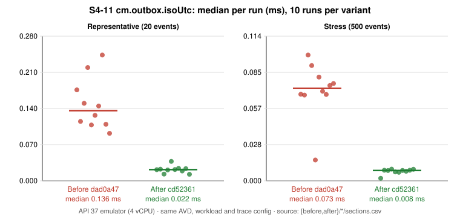

# Sprint 4 — Micro-optimization of UTC timestamp formatting in event admission (S4-11)

Issue: [S4-11 / #50](https://github.com/ConstruccionAplicacionesMovilesGrupo24/Sprint-2-Kotlin/issues/50).
Owner: Daniel (@dvargasl2). Reviewer: Juan Pablo (@bedoya0611). Protocol: `SPRINT4_PROFILING_PROTOCOL.md` (S4-02).

**Result.** Formatting one `occurredAt` timestamp went from **0.136 ms to 0.022 ms** in the representative burst and from
**0.073 ms to 0.008 ms** in the stress burst (median of run medians; −84 % and −89 %), with non-overlapping ranges and
byte-identical stored payloads. Formatting was **3.5 % (representative) and 7.0 % (stress)** of the admission time
before the change and 0.3 % / 0.5 % after. For the **whole admission** (payload, timestamp, session lock and Room commit)
**no difference was demonstrated**: its run-to-run variation on the emulator is far larger than the time removed. No
claim is made about network round-trip time, which this work never measures.

## 1. Hot path

`core/outbox/OutboxRepository.kt::isoUtc` is called once per admitted event (BQ6 usage, BQ8 recommendation events and,
since S4-10, BQ1 performance telemetry). Before the change it built and configured a new formatter every time:

```kotlin
// before (dad0a47)
SimpleDateFormat("yyyy-MM-dd'T'HH:mm:ss'Z'", Locale.US)
    .apply { timeZone = TimeZone.getTimeZone("UTC") }
    .format(Date(epochMillis))
```

On Android the `SimpleDateFormat` constructor parses the pattern and loads locale symbols and a number format, and
`TimeZone.getTimeZone` looks the zone up, for every event. Sprint 4 telemetry increases how many events are admitted.

## 2. Change ([`cd52361`](https://github.com/ConstruccionAplicacionesMovilesGrupo24/Sprint-2-Kotlin/commit/cd52361))

Source links: [before](https://github.com/ConstruccionAplicacionesMovilesGrupo24/Sprint-2-Kotlin/blob/dad0a47/android/app/src/main/java/com/campusmeal/android/core/outbox/OutboxRepository.kt)
· [after](https://github.com/ConstruccionAplicacionesMovilesGrupo24/Sprint-2-Kotlin/blob/cd52361/android/app/src/main/java/com/campusmeal/android/core/outbox/UtcTimestamps.kt)
· [diff](https://github.com/ConstruccionAplicacionesMovilesGrupo24/Sprint-2-Kotlin/compare/dad0a47...cd52361).

`git diff --stat dad0a47 cd52361 -- android/app/src/main android/app/src/profile android/gradle android/app/build.gradle.kts`
lists only `OutboxRepository.kt` (+1 −9) and the new `UtcTimestamps.kt`. The same commit adds the JVM equivalence test.

```kotlin
// after: core/outbox/UtcTimestamps.kt
private val formatter = object : ThreadLocal<SimpleDateFormat>() {
    override fun initialValue() =
        SimpleDateFormat(PATTERN, Locale.US).apply { timeZone = TimeZone.getTimeZone("UTC") }
}
fun format(epochMillis: Long): String = formatter.get()!!.format(Date(epochMillis))

// OutboxRepository.kt
private fun isoUtc(epochMillis: Long): String =
    traceSection(TraceSections.OUTBOX_ISO_UTC) { UtcTimestamps.format(epochMillis) }
```

| Property | How |
|---|---|
| Thread safety | `SimpleDateFormat` is mutable (it formats through an internal `Calendar`), so one global instance is invalid. Each thread gets its own, configured once |
| Bounded | One formatter per thread that admits events: the coroutine dispatchers (Default = cores, IO ≤ 64) and the main thread are bounded pools |
| No account data retained | A formatter holds the pattern, UTC, US symbols and the last instant it formatted; never an account id, event id or payload |
| Same wire format | Same pattern, `Locale.US` and UTC as before: `yyyy-MM-dd'T'HH:mm:ss'Z'`, milliseconds truncated |
| Same instant semantics | Callers still pass the original `occurredAtEpochMillis`; nothing else in admission changed |
| No new dependency | `java.time` was not used: it needs API 26 (minSdk is 24) or core-library desugaring, which would change both builds |
| Trace section | `cm.outbox.isoUtc` keeps its name and place, so the before/after sections measure the same thing |

## 3. Byte-identical output

**JVM** — `app/src/test/java/…/core/outbox/UtcTimestampsTest.kt`
(`./gradlew :app:testDebugUnitTest --tests '*UtcTimestampsTest*'`). The reference is the verbatim body of the old `isoUtc`.

| Test | Checks |
|---|---|
| `boundariesMatchExpectedAndReference` | 11 instants against strings computed independently (Python `datetime`): epoch, epoch + 999 ms (truncation), −1 ms, month end, year end/start, 29 Feb 2028 and the next day, 2038-01-19T03:14:08Z, 9999-12-31T23:59:59.999 |
| `deviceZoneAndLocaleDoNotChangeOutput` | Same strings with the default zone set to America/Bogota, Pacific/Kiritimati, Asia/Kathmandu and the default locale to `ar-EG`, `th-TH-u-ca-buddhist`, `fa-IR` (non-Latin digits, Buddhist calendar) |
| `randomInstantsMatchReference` | 100 000 seeded instants between 1900 and 2100 |
| `concurrentCallersMatchReference` | 8 threads started together by a barrier, 160 000 timestamps, compared with the reference |

| Run | Result |
|---|---|
| Optimized formatter | 4 tests, 0 failures, 0 skipped |
| Sensitivity: one shared `SimpleDateFormat` instead of the thread-local one | `concurrentCallersMatchReference` fails: 140 662 of 160 000 timestamps wrong. The check does detect the unsafe variant |

**Device** — the burst stores rows with fixed ids and instants (2026-12-31T23:59:50.123Z onwards, so every burst crosses a
second, minute, hour, day, month and year boundary with non-zero milliseconds). The SHA-256 of every stored
`clientEventId` + payload is printed after each run:

| Workload | Before (10 runs) | After (10 runs) |
|---|---|---|
| Representative | `17370343…c5be644` in all runs | same in all runs |
| Stress | `46bee4e0…df85fa1c` in all runs | same in all runs |
| `check` mode: stress burst by 1 caller vs 8 concurrent callers on `Dispatchers.Default` | `MATCH` | `MATCH` |

## 4. Measurement

The burst (`app/src/profile/…/profiling/OutboxBurst.kt`, profile build only, added in `dad0a47` before the optimization)
builds its own `OutboxRepository` over a disposable on-disk Room database and DataStore, with a synthetic account, a
scheduler that does nothing and APIs that throw if called. The trace therefore contains event admission only, including
the real SQLite commit, and never backend latency. Conditions, APK hashes and the discarded capture are in
`docs/evidence/sprint4/s4-11-iso-utc/conditions.md`.

| | Before | After |
|---|---|---|
| Git | `dad0a47` | `cd52361` |
| Device | API 37 emulator, 4 vCPU, 4 GB, Apple M4 Pro host | same |
| Per run | Perfetto (`campusmeal.pbtxt`), fresh process, 50-event warmup, traced burst | same |

Values extracted with `scripts/profiling/sections.js`, cut to the `cm.s4-11.burst` window and totalled per run with
`scripts/profiling/s4-11-window.js`, summarized with `scripts/profiling/summary.js`.

### 4.1 Formatter (`cm.outbox.isoUtc`, one timestamp)

| Workload | Variant | Runs | Per-run medians (ms) | Median of runs | Range |
|---|---|---:|---|---:|---|
| Representative (20 events) | Before | 10 | 0.176, 0.115, 0.150, 0.219, 0.108, 0.127, 0.145, 0.244, 0.110, 0.092 | **0.136** | 0.092–0.244 |
| | After | 10 | 0.022, 0.023, 0.013, 0.021, 0.038, 0.022, 0.024, 0.019, 0.024, 0.013 | **0.022** | 0.013–0.038 |
| Stress (500 events) | Before | 10 | 0.068, 0.067, 0.099, 0.090, 0.016, 0.081, 0.070, 0.068, 0.075, 0.076 | **0.073** | 0.016–0.099 |
| | After | 10 | 0.002, 0.008, 0.008, 0.009, 0.007, 0.007, 0.008, 0.007, 0.008, 0.009 | **0.008** | 0.002–0.009 |



Improvement: representative (0.136 − 0.022) / 0.136 = **83.8 %** (6.2×); stress (0.073 − 0.008) / 0.073 = **89.0 %**
(9.1×). In both workloads the slowest "after" run is faster than the fastest "before" run, so the benefit exceeds the
observed variation.

### 4.2 Whole admission (`cm.outbox.enqueue`, summed per burst)

Median of the per-run values, with the range:

| Workload | Variant | Admission sum (ms) | Formatter sum (ms) | Formatter share of admission |
|---|---|---|---|---|
| Representative | Before | 227.3 (47.2–503.6) | 3.79 (2.68–37.44) | **3.5 %** (0.8–11.1 %) |
| | After | 430.5 (40.5–908.0) | 0.94 (0.48–55.37) | 0.3 % (0.1–7.4 %) |
| Stress | Before | 2 169.2 (397.6–2 871.6) | 137.8 (12.0–238.9) | **7.0 %** (3.0–9.9 %) |
| | After | 1 683.6 (401.2–2 967.9) | 6.78 (1.88–66.01) | 0.5 % (0.4–3.1 %) |

The admission ranges overlap in both workloads: **no difference in total admission time is demonstrated**, neither an
improvement nor a regression. The representative median is higher "after", but its range contains the "before" one and
the only code that changed got faster (formatter sum −75 %); the rest of admission (session lock and SQLite commit) is
unchanged code whose duration on the emulator varies from 40 ms to 900 ms per 20-event burst. Single slow calls (up to
~50 ms) in both variants are host preemption or garbage collection, not formatting: the medians are unaffected.

## 5. Interpretation and limits

- The change removes the per-event formatter construction; per event it saves about 0.07–0.11 ms on this emulator. That
  is at most the 3.5–7 % of admission time that formatting used to take; the Room transaction dominates admission.
- Users would not notice it in one session. It is a bounded allocation/CPU saving that grows with telemetry volume.
- **Emulator, not a phone.** The owner has no Android phone, so both variants ran on the same AVD on the same host
  (protocol §3, condition 1). Absolute timings include host scheduling and are not representative of a phone; only the
  paired comparison is used. Load rose during the series (end load average 6.7 "before", 8.4 "after"). A first capture on
  a 1-vCPU AVD was discarded for noise before any "after" run (`conditions.md`).
- Timings are wall-clock section durations of a system trace; each trace marker adds a small fixed cost to both variants.
- A Java allocation profile was not recorded (optional in the issue); the CPU-time reduction is the evidence.
- Reviews (`enqueueReview`) do not format a timestamp and are not part of the burst.

## 6. Reproduce

```bash
./gradlew :app:testDebugUnitTest --tests '*UtcTimestampsTest*'
git checkout dad0a47   # then cd52361 for "after"
./gradlew :app:assembleProfile && adb install -r app/build/outputs/apk/profile/app-profile.apk
adb shell cmd package compile -m speed -f com.campusmeal.android.profile
scripts/profiling/s4-11-burst.sh docs/evidence/sprint4/s4-11-iso-utc/before/representative representative 10
scripts/profiling/s4-11-burst.sh docs/evidence/sprint4/s4-11-iso-utc/before/stress stress 10
adb shell am start -W -S -n com.campusmeal.android.profile/com.campusmeal.android.profiling.OutboxBurstActivity --es cm.outbox.burst check
```

## 7. Acceptance (S4-11)

- [x] Dedicated diff and byte-identical timestamp outputs over boundary fixtures, including concurrent callers (§2, §3).
- [x] Reproducible profiler evidence of reduced CPU work with no material overall regression (§4; total admission: no difference demonstrated either way).
- [x] Results state how much of event-admission cost was affected (3.5–7 %), no network claim (§4.2, §5).
- [x] A useful, measurable benefit appeared in the formatter section, so no other hotspot had to be selected.
- [x] This document contains source, logs, figures and limitations; raw files in `docs/evidence/sprint4/s4-11-iso-utc/`.
